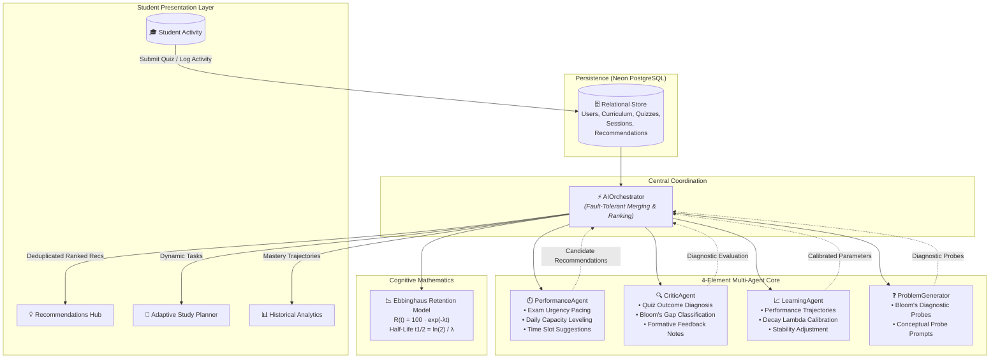
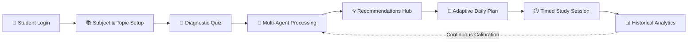

<div align="center">

# 🧠 NeuroLearn

### *Your AI-Powered Adaptive Learning Companion*

[](https://react.dev/)
[](https://fastapi.tiangolo.com/)
[](https://www.python.org/)
[](https://www.postgresql.org/)
[](https://vitejs.dev/)
[](https://tailwindcss.com/)
[](https://opensource.org/licenses/MIT)

<p align="center">
  <b>NeuroLearn</b> is an intelligent, personalized academic planning ecosystem. By combining an autonomous <b>4-Element Learning Agent Architecture</b> with a mathematical <b>Ebbinghaus Cognitive Retention Engine</b>, NeuroLearn replaces rigid study calendars with dynamic, performance-calibrated revision schedules designed to maximize exam mastery.
</p>

[🌐 Live Web Application](https://neurolearn-wine-eta.vercel.app/) • [📖 Interactive API Docs](https://neurolearn-28i3.onrender.com/api/docs) • [🐙 GitHub Repository](https://github.com/adiityakr05/NeuroLearn)

---

[About NeuroLearn](#-about-neurolearn) • [Key Features](#-key-features) • [AI Agent Architecture](#-ai-agent-architecture) • [How It Works](#-how-it-works) • [Retention Model](#-cognitive-retention-model) • [Screenshots](#-screenshots--ui-walkthrough) • [Tech Stack](#-technology-stack) • [Project Structure](#-project-structure) • [Setup & Installation](#-installation--local-setup) • [Deployment](#-live-deployment) • [Future Roadmap](#-future-roadmap)

</div>

---

## 📖 About NeuroLearn

### The Problem with Static Study Calendars
Most university students rely on fixed study schedules that treat all topics uniformly. These static planners fail because human memory does not deteriorate linearly:
- **Uneven Topic Difficulty:** Complex topics require higher initial repetition and faster diagnostic remediation than straightforward topics.
- **Cognitive Decay (Forgetting):** Without scheduled active recall, conceptual retention drops precipitously within days of learning.
- **Fixed Exam Deadlines:** Academic calendars impose strict deadlines, requiring intelligent pacing optimization rather than naive time-blocking.

### The NeuroLearn Solution
NeuroLearn monitors student diagnostic quiz results, historical recall stability, topic difficulty ratings, and target exam dates to continuously recalculate daily study recommendations. Instead of dictating a static routine, NeuroLearn:
1. **Calibrates Cognitive Decay:** Adjusts forgetting curve parameters based on actual quiz recall accuracy.
2. **Prioritizes Urgent Knowledge Gaps:** Directs attention to high-difficulty, low-mastery topics with imminent exam deadlines.
3. **Levels Study Load:** Suggests realistic daily revision sessions fitted to the student's available study capacity.

---

## ✨ Key Features

| Feature | Description |
|:---|:---|
| 🎯 **Personalized Study Planning** | Generates daily and weekly study agendas dynamically balanced by exam dates, topic mastery, and measured study pacing. |
| 📚 **Subject & Topic Management** | Hierarchical curriculum organization with custom color tags, target mastery thresholds, difficulty ratings, and exam deadlines. |
| 📝 **Diagnostic Quizzes & Idempotency** | In-app assessments with built-in idempotent submission replay (`uq_user_quiz_idempotency`), preventing accidental score inflation. |
| 💡 **Explainable AI Recommendations Hub** | Transparent recommendations categorized by agent element (`Performance Element`, `Critic`, `Learning Element`, `Problem Generator`) with one-click acceptance and feedback. |
| 🔁 **Spaced Repetition Engine** | Mathematical scheduling of revision intervals ensuring topics are resurfaced before memory retention falls below the critical threshold (default 70%). |
| ⏱️ **Study Session Lifecycle Tracking** | Real-time session timers tracking status transitions (`pending` &rarr; `in_progress` &rarr; `completed` / `abandoned`) while measuring true elapsed study minutes. |
| 📊 **Historical Analytics & Trajectories** | 30-day analytics reconstructing mastery trajectories via Exponential Moving Average (EMA), tracking actual vs. planned study time and quiz trends. |

---

## 🤖 AI Agent Architecture

NeuroLearn implements an autonomous **4-Element Multi-Agent Architecture** coordinated by a central orchestrator. Each agent handles a specific cognitive learning dimension:



### Component Roles & Responsibilities
- **`PerformanceAgent`:** Evaluates exam proximity, current mastery delta, and daily student capacity. Generates structured study tasks with specific time slot allocations (e.g., `Evening (07:00 PM - 08:30 PM)`).
- **`CriticAgent`:** Examines diagnostic quiz accuracy and error patterns across cognitive dimensions (Recall, Application, Analysis). Produces human-readable feedback notes and remediation flags.
- **`LearningAgent`:** Analyzes chronological performance sequences to determine student learning stability. Adjusts the topic-specific memory decay rate parameter $\lambda$.
- **`ProblemGenerator`:** Formulates diagnostic probe questions tailored to diagnosed weak spots across Bloom's Taxonomy tiers.
- **`AIOrchestrator`:** Orchestrates isolated agent runs with individual fallback handling, deduplicates candidate recommendations, normalizes priority tiers (`urgent` > `high` > `medium` > `low`), and persists actions.

---

## 🔄 How It Works

The complete end-to-end learning lifecycle follows an adaptive closed-loop feedback workflow:



1. **Curriculum Definition:** The student creates subjects with target mastery scores and exam deadlines, organizing them into topics with assigned difficulty ratings (`Easy`, `Medium`, `Hard`).
2. **Diagnostic Evaluation:** The student completes quizzes. Submissions are verified through idempotency keys to ensure transactional reliability.
3. **Multi-Agent Evaluation:** The `CriticAgent` scores the assessment and provides constructive notes, while the `LearningAgent` updates topic mastery and decay stability.
4. **Actionable Recommendations:** The `AIOrchestrator` merges agent proposals into the **Recommendations Hub**.
5. **Adaptive Study Planning:** Accepted recommendations are scheduled into the student's daily study plan, integrated with spaced repetition intervals.
6. **Session Execution & Feedback:** Timed study sessions record measured study duration and feed the 30-day historical analytics engine.

---

## 📉 Cognitive Retention Model

NeuroLearn models memory retention using the mathematical formulation of Hermann Ebbinghaus's exponential forgetting curve:

$$R(t) = 100 \cdot e^{-\lambda t}$$

Where:
- $R(t) \in [0.0, 100.0]$: Percentage memory retention remaining after elapsed time $t$.
- $t \ge 0$: Elapsed time in days since the last study session or active recall event.
- $\lambda \in [0.01, 0.30]$: Topic-specific decay rate parameter (baseline default $\lambda = 0.08$).

### Memory Half-Life
The time in days required for retained knowledge to decay to 50% of its initial stability:
$$t_{1/2} = \frac{\ln(2)}{\lambda}$$
For the baseline default $\lambda = 0.08$, $t_{1/2} \approx 8.66\text{ days}$.

### Spaced Repetition Scheduling Formula
Revision intervals target a safety threshold $R_{\text{target}}$ (default $70.0\%$):
$$t_{\text{rev}} = \max\left(1, \operatorname{round}\left(\frac{-\ln(R_{\text{target}} / 100)}{\lambda}\right)\right)$$

### Dynamic Stability Calibration
Upon active recall or quiz completion with score $S \in [0.0, 100.0]$, the decay rate $\lambda$ is recalibrated:
- **Strong Recall ($S \ge 80\%$):** Memory consolidation occurs; forgetting slows:
  $$\lambda_{\text{new}} = \lambda \cdot \left(0.60 + 0.20 \cdot \frac{100 - S}{100}\right)$$
- **Moderate Recall ($60\% \le S < 80\%$):** Mild consolidation:
  $$\lambda_{\text{new}} = \lambda \cdot \left(0.85 + 0.15 \cdot \frac{80 - S}{20}\right)$$
- **Weak Recall ($S < 60\%$):** Immediate forgetting risk; revision frequency accelerates:
  $$\lambda_{\text{new}} = \lambda \cdot \left(1.10 + 0.40 \cdot \frac{60 - S}{60}\right)$$
- *All calibrated $\lambda$ values are bounded strictly within $[\text{MIN\_LAMBDA}, \text{MAX\_LAMBDA}] = [0.01, 0.30]$.*

> **Note on Implementation:** NeuroLearn's retention engine is a deterministic, mathematically calibrated cognitive model based on empirical memory dynamics, rather than an opaque deep neural network.

---

## 📸 Screenshots & UI Walkthrough

| View | Description | Suggested Screenshot Asset |
|:---|:---|:---:|
| **Student Dashboard** | Overall study streak, weekly study minutes, subject mastery bars, and upcoming exam countdowns. | `docs/screenshots/dashboard.png` |
| **Adaptive Study Planner** | Chronological daily tasks with difficulty badges, priority indicators, and interactive completion timers. | `docs/screenshots/planner.png` |
| **Recommendations Hub** | Multi-element AI recommendation cards with element badges (`Critic`, `Performance`, etc.) and one-click scheduling. | `docs/screenshots/recommendations.png` |
| **Historical Analytics** | Recharts visualizations of retention decay curves, quiz score trends, and subject mastery comparisons. | `docs/screenshots/analytics.png` |

> *Tip: To add screenshots to this section, capture the respective views from the deployed application and save them under `docs/screenshots/`.*

---

## 🛠️ Technology Stack

```text
┌────────────────────────────────────────────────────────────────────────┐
│                          NEUROLEARN STACK                              │
├──────────────────┬──────────────────┬──────────────────┬───────────────┤
│ Frontend (SPA)   │ Backend (API)    │ Database & ORM   │ Security & AI │
├──────────────────┼──────────────────┼──────────────────┼───────────────┤
│ • React 19.3     │ • FastAPI 0.115  │ • PostgreSQL 16  │ • Argon2id    │
│ • Vite 8.3       │ • Python 3.13    │ • SQLAlchemy 2.0 │ • PyJWT HS256 │
│ • Tailwind v4.3  │ • Uvicorn 0.32   │ • Alembic 1.14   │ • Multi-Agent │
│ • React Router 7 │ • Pydantic v2.10 │ • Psycopg2-Binary│ • Ebbinghaus  │
│ • Recharts 3.10  │ • Pydantic-Set.  │ • SQLite (Local) │   Decay Math  │
│ • Axios 1.21     │ • HTTPX 0.28     │                  │               │
└──────────────────┴──────────────────┴──────────────────┴───────────────┘
```

- **Frontend:** React 19, Vite 8, Tailwind CSS v4, React Router v7 (lazy-loaded routes), Recharts, Axios, Lucide React icons.
- **Backend Framework:** FastAPI, Uvicorn, Python 3.13.
- **Data & Migration:** SQLAlchemy 2.0 (ORM), Alembic (automated schema migrations), PostgreSQL (production target via Neon), SQLite (zero-setup local fallback).
- **Security & Cryptography:** Argon2id password hashing (`argon2-cffi`), PyJWT (HS256) bearer token management, CORS strict origin enforcement.
- **Testing & Verification:** Pytest (192 unit and integration tests), central PostgreSQL test fixtures, pytest-asyncio.
- **Deployment & Cloud:** Vercel (Frontend Edge CDN), Render (Backend Python Web Service), Neon (Serverless PostgreSQL).

---

## 📂 Project Structure

```text
NeuroLearn/
├── backend/
│   ├── alembic/                      # Database schema migration revisions
│   │   ├── versions/                 # Linear migration history (head: c82e50f2bb23)
│   │   └── env.py                    # Alembic migration environment & URL normalization
│   ├── app/
│   │   ├── agents/                   # 4-Element AI Agent architecture & central Orchestrator
│   │   │   ├── base.py               # Abstract BaseAgent contract
│   │   │   ├── context.py            # StudentContextBuilder & data aggregators
│   │   │   ├── critic_agent.py       # Quiz outcome & gap evaluator
│   │   │   ├── learning_agent.py     # Trajectory classifier & decay calibrator
│   │   │   ├── orchestrator.py       # Multi-agent coordinator & candidate deduplicator
│   │   │   ├── performance_agent.py  # Exam urgency & study pacing planner
│   │   │   └── problem_generator.py  # Bloom's diagnostic probe generator
│   │   ├── api/                      # REST API endpoints & route handlers
│   │   │   └── v1/
│   │   │       ├── endpoints/        # Auth, Subjects, Sessions, Quizzes, Recs, Analytics
│   │   │       └── router.py         # Consolidated API v1 router
│   │   ├── core/                     # Configuration (Pydantic Settings) & security hashing
│   │   ├── db/                       # SQLAlchemy SessionLocal, engine, and base
│   │   ├── ml/                       # Ebbinghaus retention model & decay calibrator
│   │   ├── models/                   # SQLAlchemy declarative database entities
│   │   ├── schemas/                  # Pydantic v2 validation models
│   │   ├── services/                 # Decoupled business logic (Activity, Planner, Analytics)
│   │   └── main.py                   # FastAPI application initialization & middleware
│   ├── tests/                        # Comprehensive test suite (192 tests passing)
│   │   ├── conftest.py               # Centralized PostgreSQL / SQLite test fixtures
│   │   └── evaluation/               # Agent evaluation metrics & synthetic student profiles
│   ├── requirements.txt              # Production Python dependencies
│   ├── alembic.ini                   # Alembic configuration file
│   └── .env.example                  # Backend environment configuration template
├── frontend/
│   ├── src/
│   │   ├── components/               # Navbar, Sidebar, and shared UI widgets
│   │   ├── context/                  # AuthContext and state providers
│   │   ├── pages/                    # Dashboard, StudyPlanner, Subjects, Recommendations, Analytics
│   │   ├── services/                 # Axios HTTP client, data normalizers, mock switches
│   │   ├── App.jsx                   # React Router route registry
│   │   └── main.jsx                  # React DOM mount point
│   ├── package.json                  # Frontend dependencies and Vite scripts
│   ├── vite.config.js                # Vite build and Tailwind CSS configuration
│   ├── vercel.json                   # Vercel SPA routing and caching configuration
│   └── .env.production.example       # Frontend production environment template
├── .dockerignore                     # Docker build exclusion rules
├── Dockerfile                        # Multi-stage production container manifest
├── render.yaml                       # Render Web Service deployment specification
├── vercel.json                       # Root-level Vercel deployment configuration
└── README.md                         # Project documentation
```

---

## 🚀 Installation & Local Setup

### Prerequisites
- **Python:** 3.11+ (Python 3.13 recommended)
- **Node.js:** 18+ (Node.js 20 LTS recommended)
- **Package Managers:** `pip` and `npm`

### 1. Backend Setup
```bash
# Navigate to backend directory
cd backend

# Create and activate virtual environment
python -m venv venv
# On Windows:
.\venv\Scripts\activate
# On Linux/macOS:
# source venv/bin/activate

# Install dependencies
pip install -r requirements.txt

# Configure environment variables
cp .env.example .env

# Run database migrations (defaults to local SQLite neurolearn.db)
alembic upgrade head

# Run automated test suite
pytest tests -v

# Start local FastAPI backend server
uvicorn app.main:app --host 0.0.0.0 --port 8000 --reload
```
API Documentation will be live at `http://localhost:8000/api/docs`.

### 2. Frontend Setup
```bash
# In a new terminal, navigate to frontend directory
cd frontend

# Install dependencies
npm install

# Configure development environment
cp .env.example .env.local

# Start Vite development server
npm run dev
```
Frontend development server will be live at `http://localhost:5173`.

---

## 🌐 Live Deployment

NeuroLearn is deployed across modern cloud infrastructure:

- **Frontend (Vercel):** [https://neurolearn-wine-eta.vercel.app/](https://neurolearn-wine-eta.vercel.app/)  
  *Configured as a React 19 Vite Single Page Application with edge caching and client-side rewrites.*
- **Backend (Render):** [https://neurolearn-28i3.onrender.com](https://neurolearn-28i3.onrender.com)  
  *FastAPI application running on a Python web service with automatic database migrations.*
- **API Documentation (Swagger UI):** [https://neurolearn-28i3.onrender.com/api/docs](https://neurolearn-28i3.onrender.com/api/docs)  
  *Live interactive endpoint documentation.*
- **Database (Neon PostgreSQL):** Serverless PostgreSQL 16 cluster with automated connection pooling and SSL encryption.

---

## 🔮 Future Roadmap

- [ ] **Collaborative Study Cohorts:** Shared curriculum decks and peer benchmarking.
- [ ] **Flashcard Active Recall Mode:** Native Leitner-box flashcard drills directly linked to topic decay rates.
- [ ] **LMS Integrations:** Exporting study schedules to Google Calendar, Apple Calendar, and Canvas via iCal standards.
- [ ] **LLM-Augmented Probe Generation:** Deep learning integration for generating tailored diagnostic quizzes from student-provided textbook passages.
- [ ] **Native Mobile Client:** React Native companion application for study notifications and active recall reminders.

---

## 🤝 Contribution & License

Contributions, issues, and feature requests are welcome!

1. Fork the repository on GitHub.
2. Create a feature branch (`git checkout -b feature/amazing-feature`).
3. Commit your changes (`git commit -m 'feat: add amazing feature'`).
4. Push to the branch (`git push origin feature/amazing-feature`).
5. Open a Pull Request.

### License
This project is open-source and distributed under the **MIT License**. See the [LICENSE](https://opensource.org/licenses/MIT) file for details.

---

<div align="center">
  <sub>Built with ❤️ for university students seeking smarter, stress-free academic success.</sub>
</div>


1. Fork the repository on GitHub.
2. Create a feature branch (`git checkout -b feature/amazing-feature`).
3. Commit your changes (`git commit -m 'feat: add amazing feature'`).
4. Push to the branch (`git push origin feature/amazing-feature`).
5. Open a Pull Request.

### License
This project is open-source and distributed under the **MIT License**. See the [LICENSE](https://opensource.org/licenses/MIT) file for details.

---

<div align="center">
  <sub>Built with ❤️ for university students seeking smarter, stress-free academic success.</sub>
</div>
